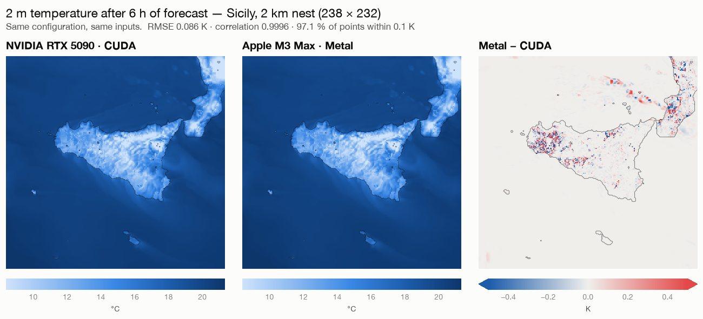

# ArWen su Apple Silicon

[English](README.md) · **Italiano**

### Un modello meteorologico regionale di classe WRF che gira nativamente sulla GPU di un Mac

Questo repository è **[ArWen](https://github.com/recastsystems/arwen)** —
l'implementazione GPU della famiglia di modelli WRF-ARW di Recast Systems
(Apache-2.0) — con in più un **backend Apple Metal**.  ArWen è il progetto
originale e principale: il nucleo dinamico, la fisica, i percorsi dei dati e
gli strumenti sono loro, e il loro README è conservato come
[`README-ArWen.md`](README-ArWen.md).  Questo fork aggiunge una cosa sola: i
kernel CUDA di previsione di ArWen girano sulla GPU di un Mac con Apple
Silicon, senza hardware NVIDIA, senza runtime CUDA e senza emulatori in mezzo.

Per quanto ne sappiamo, è la prima volta che una previsione completa di classe
WRF-ARW — domini annidati, microfisica Thompson, strato limite MYNN,
radiazione RRTMG, suolo Noah, convezione Tiedtke — gira nativamente sulla GPU
di un Mac.

<picture>
  <source media="(prefers-color-scheme: dark)" srcset="docs/metal-assets/t2_6h_dark.png">
  
</picture>

*La stessa previsione a 6 ore calcolata da ArWen originale su una NVIDIA RTX
5090 e da questo backend sull'M3 Max di un MacBook Pro.  La mappa delle
differenze mostra cosa resta: arrotondamenti sparsi, amplificati da sei ore di
un modello caotico, soprattutto sulla terraferma, dove convezione e schema di
superficie li fanno crescere.*

```sh
gpuwm go /percorso/della/run_wrf --backend metal --history-compression none
```

**In sintesi**

| | |
|---|---|
| cosa gira | i kernel CUDA di ArWen, tradotti in Metal al primo uso — nessun port scritto a mano, nessun hardware NVIDIA, nessun emulatore |
| previsione | configurazione WRF operativa a due domini (6 km / 2 km, 45 livelli): run da 1 h e da 6 h completate |
| contro una RTX 5090 | identica parola per parola alle 00:00; dopo 6 h, RMSE della temperatura a 2 m 0,09 K e correlazione della pressione al suolo 1,0000 |
| riproducibilità | 142 775 319 parole di output identiche da una run all'altra, ricontrollate dopo ogni modifica |
| controlli di esattezza | emulazione binary64 a 0 ulp; underflow graduale FP32, costrutti del traduttore ed eliminazione dei `goto` a 0 parole diverse; percorsi veloci della libm glibc verificati su tutti i 2³² input |
| copertura | compilano tutte le 342 unità di traduzione CUDA e 46 / 46 loader di produzione |
| suite di test GPU di ArWen | 13 458 test: 150 falliti (1,1 %), 513 saltati perché non applicabili su un Mac, con la motivazione dichiarata, tutti gli altri passano |
| velocità | 1 ora simulata in 81–240 s su un portatile M3 Max (RTX 5090: ~11 s) |

---

## Indice

1. [Risultati](#risultati)
2. [Come funziona](#come-funziona)
3. [Verifica](#verifica)
4. [Cosa ha scoperto il port](#cosa-ha-scoperto-il-port)
5. [Copertura](#copertura)
6. [Per iniziare](#per-iniziare)
7. [Configurazione](#configurazione)
8. [Limiti noti](#limiti-noti)
9. [Cosa resta, e cosa si può risolvere](#cosa-resta-e-cosa-si-può-risolvere)
10. [Mappa del repository](#mappa-del-repository)
11. [Crediti e licenza](#crediti-e-licenza)

---

## Risultati

Misurato su un **Apple M3 Max** (GPU a 30 core, 36 GB di memoria unificata,
macOS 27.2, Xcode 27.2, toolchain Metal 32023.922), contro la stessa
configurazione eseguita da ArWen 3.0.3 originale su una **NVIDIA RTX 5090**.

**La configurazione** è operativa: due domini annidati one-way sulla Sicilia —
d01 176×152 a 6 km, d02 238×232 a 2 km — 45 livelli, `hybrid_opt=2`,
`p_top=5000`, passo temporale adattivo; Thompson (`mp_physics=8`), Tiedtke
(`cu_physics=6`, d01), RRTMG LW/SW (`ra_*_physics=4`), MYNN per strato limite e
strato superficiale (5/5), Noah LSM (`sf_surface_physics=2`), `diff_opt=1`,
`km_opt=4`, `sst_update=1`.  Input: i file di `real.exe` di WRF.  Output:
`wrfout` NetCDF classico, leggibile da UPP.

**Arriva in fondo** — previsioni da 1 h (309 passi) e da 6 h (1 859 passi),
con la stessa sequenza di passi adattivi della run CUDA.

**Concorda con CUDA** entro la crescita caotica degli arrotondamenti.  Alle
00:00 i campi sono identici parola per parola; dopo, Metal − CUDA:

| campo | RMSE 1 h d01 | RMSE 1 h d02 | RMSE 6 h d01 | RMSE 6 h d02 | corr 6 h d02 |
|---|---|---|---|---|---|
| temperatura a 2 m (K) | 0,039 | 0,055 | 0,045 | 0,086 | 0,9996 |
| velocità del vento a 10 m (m/s) | 0,016 | 0,014 | 0,038 | 0,076 | 0,9994 |
| pressione al suolo (Pa) | 0,30 | 0,076 | 0,46 | 1,26 | 1,0000 |
| pioggia accumulata (mm) | 7,6e-5 | 2,4e-5 | 0,017 | 0,057 | 0,979 |

**È deterministico** — run ripetute della stessa build producono le stesse
142 775 319 parole di output, bit per bit.

**Velocità** — un'ora simulata richiede 81–240 s di tempo reale sull'M3 Max, a
seconda di cos'altro sta facendo la macchina (miglior misura: passo mediano
0,23 s su d02, 0,13 s su d01); sei ore hanno richiesto 885 s.  La RTX 5090 fa
un'ora in circa 10,6 s: una scheda desktop da 575 W con 1,8 TB/s e FP64
nativo, contro una GPU da portatile che deve emulare FP64 in software (sotto).

## Come funziona

I sorgenti CUDA restano quelli canonici.  Niente è portato a mano: ogni kernel
che ArWen compila durante l'esecuzione viene tradotto in Metal Shading
Language la prima volta che serve, compilato e messo in cache.

```
ArWen (Python)  ──  chiama CuPy  ──►  gpuwm/metal/shim.py installa gpuwm/metal/xp come "cupy"
                                        gli array stanno in memoria unificata; i kernel sono Metal
sorgente del kernel CUDA + opzioni NVRTC (esattamente ciò che costruiscono i loader di ArWen)
   │  preprocessore clang con le macro predefinite di NVRTC
   │  parsing libclang, modalità device CUDA, contro gpuwm/metal/cuda_parse.h
   ▼
gpuwm/metal/transpile.py — riscrittura in MSL guidata dall'AST
   │  xcrun metal → AIR (.metallib), in cache in ~/.cache/arwen-metal
   ▼
gpuwm/metal/native/arwen_metal_rt.mm — MTLDevice, buffer, pipeline,
   command buffer ordinati (catena MTLEvent solo GPU), pool di buffer
```

I problemi difficili e come sono stati risolti (dettagli e misure in
[`docs/metal-backend.md`](docs/metal-backend.md), in inglese):

* **Niente FP64 sulle GPU Apple.**  La fisica dell'atmosfera ha bisogno di
  binary64 in molti punti (tabelle Thompson, la matematica `f64cr` di ArWen
  correttamente arrotondata, Noah, RRTMG).  `double` diventa `__f64`, un
  binary64 IEEE correttamente arrotondato implementato in aritmetica intera
  (`arwen_sf64.h`): 0 ulp per + − × ÷ √ fma, verificato su valori speciali e su
  milioni di operandi casuali contro la CPU; funzioni libm double entro 1–4
  ulp, dichiarate funzione per funzione.
* **Subnormali FP32 azzerati dall'hardware.**  Le GPU Apple precedenti alla
  famiglia 11 azzerano i denormali float.  I moduli che ArWen compila con
  `--ftz=false` di CUDA passano ogni operazione float attraverso funzioni che
  recuperano esattamente l'underflow graduale, con un test economico sul solo
  risultato perché il caso comune resti veloce.
* **Copie esatte della libm float di glibc.**  ArWen include `logf`/`expf`/
  `powf` di glibc per concordare bit per bit con WRF; lavorano in binary64,
  costoso qui.  Sono instradate su percorsi veloci float-float il cui accordo
  con la copia glibc è verificato su **tutti i 2³² input** prima di attivare
  l'instradamento.
* **CUDA → MSL.**  Gli spazi di indirizzamento sono dedotti dal flusso dei dati
  (device, thread, threadgroup, constant); le funzioni device sono
  monomorfizzate per spazio di indirizzamento; i `goto` (Fortran tradotto)
  sono eliminati in modo esatto; l'ereditarietà è appiattita; le primitive di
  warp diventano SIMD-group; le viste di array che avvolgono sia memoria locale
  sia device ricevono il tipo di puntatore come parametro template; i pattern
  PTX inline sono mappati uno per uno.  Ciò che il traduttore non sa esprimere
  è un `TranslationError` — mai un cambiamento silenzioso.
* **Il compilatore back-end GPU di Apple.**  Per alcuni kernel molto grandi la
  compilazione `-O3` richiede decine di minuti; il runtime usa allora AIR
  `-Os` (verificato: calcola le stesse parole) e si ricorda il kernel.
* **Costo lato host.**  Una catena di ordinamento solo GPU, commit anticipati,
  un pool di buffer e il packing degli argomenti in cache hanno ridotto la
  quota dell'host in un'ora di run da quasi tutto a una piccola frazione.

## Verifica

Ogni componente ha un controllo con una tolleranza dichiarata e un risultato
misurato:

| controllo | risultato |
|---|---|
| previsione 1 h / 6 h contro RTX 5090 | tabella sopra |
| previsione 1 h, run Metal contro run Metal | 0 su 142 775 319 parole diverse (ripetuto dopo ogni modifica a traduttore, runtime o strato array) |
| casi colonna Tiedtke (cu6) contro CUDA | 0 parole diverse |
| colonna Thompson del fork HRRR contro l'oracolo Fortran del fork | ogni cella di output, parola per parola |
| emulazione binary64 (`tests/metal/sf64_gpu_check.py` + controlli host) | operazioni di base a 0 ulp |
| underflow graduale FP32 (`tests/metal/ftz_false_gpu_check.py`) | 0 su 4 194 304 parole |
| strato array compatibile CuPy contro NumPy (`tests/metal/xp_parity_check.py`) | 124 controlli, 0 errori |
| costrutti del traduttore contro clang nativo (`tests/metal/translator_features_check.py`) | 27 casi, 0 parole diverse |
| membri di ensemble impacchettati in un batch contro eseguiti uno per uno (packed, scheduled, RRTMGP in batch) | 30 / 30 test, parola per parola |
| eliminazione dei `goto` contro clang nativo (`tests/metal/goto_semantics_check.py`) | 8 forme, tra cui il NEWTON di SSiB e un salto in un ramo fratello (Noah-MP), 0 parole diverse |
| colonne Kain-Fritsch (KF-CuP) contro l'oracolo Fortran di WRF, `GPUWM_WRF_EXACT=1` | 0 parole diverse, 5 configurazioni |
| percorsi veloci della libm glibc (`tools/metal/verify_fastlibm.py`) | tutti i 2³² input per funzione instradata, 0 discordanze |
| suite di test GPU di ArWen su Metal (13 458 test) | 150 falliti (1,1 %); 513 saltati perché non applicabili su un Mac, ognuno con la sua motivazione; tutti gli altri passano o sono saltati dalle condizioni di ArWen stesso (19-11-2026) |

I 513 skip sono elencati uno per uno in `tests/metal_not_applicable.py` e
applicati da `tests/conftest.py` solo con `GPUWM_BACKEND=metal`; pytest stampa
la motivazione di ciascuno.  Un test entra nell'elenco solo con un'evidenza
per la sua classe:

| classe | test | perché non si applica su un Mac |
|---|---|---|
| `ptx` | 212 | compilazioni PTX / NVRTC dirette, nvJitLink, cubin — Metal non ha PTX |
| `arwen_drift` | 155 | falliscono su qualunque backend in ArWen 3.0.3 (stesso fallimento su una RTX 5090, o errore nella fixture del test stesso) |
| `cuda_hash_pin` | 57 | SHA-256 fissati delle parole di output di CUDA, che incorporano la contrazione FMA di `ptxas` (Metal è spesso più vicino all'oracolo WRF) |
| `macos_reference` | 33 | il riferimento CPU gira sul Mac con la libm di Apple o NumPy arm64 (Metal lì concorda con glibc) |
| `cuda_host_only` | 19 | dati, strumenti o ambiente presenti solo sulla macchina Linux/CUDA |
| `kf_default_tolerance` | 15 | conteggi di parole KF-CuP con la numerica predefinita, che fallisce anche la RTX 5090; con `ARWEN_METAL_STRICT_GLIBC=1` qui girano e passano parola per parola |
| `cuda_introspection` | 14 | frame di memoria locale CUDA, registri, comportamento delle funzioni built-in di NVRTC |
| `native_libm` | 8 | distanza in ULP da WRF fissata per la `powf` hardware di CUDA; la `powf` di Apple arrotonda diversamente l'ultimo bit (Exner `pi_phy`: 1826 contro 304 parole su 5880 a 1 ULP da WRF) |

I 150 test che falliscono ancora restano nella suite.  Ogni file con
fallimenti è stato eseguito anche sulla RTX 5090, un processo per file: 105 di
questi test lì passano, quindi sono problemi lato Metal; 11 lì falliscono per
un motivo diverso; 34 sono in file non coperti dalla run CUDA.  Raggruppati
per messaggio:

| cosa | test |
|---|---|
| differenze numeriche rispetto a valori o tolleranze misurati su CUDA, e altre asserzioni da indagare | 90 |
| il compilatore shader di Apple che va in crash o rinuncia sui kernel più grandi | 25 |
| funzioni dello strato array / API CUDA non ancora presenti (`matmul`, `memcpyPeerAsync`, …) | 23 |
| contabilità di memoria e allocazioni diversa da quella di CUDA | 12 |

## Cosa ha scoperto il port

Far girare un grande codice CUDA su una seconda GPU, molto diversa, è anche
un test del codice stesso.  Oltre al backend Metal, questo lavoro ha prodotto
risultati utili ad ArWen e a chiunque porti codice CUDA sulle GPU Apple.

**In ArWen 3.0.3** (tutto riprodotto sulla RTX 5090, non sono effetti di Metal):

* **155 test GPU falliscono su qualunque backend** — test e codice si sono
  allontanati (configurazioni senza attributi che il codice ora legge,
  argomenti cambiati, valori attesi non aggiornati).  Ognuno è elencato in
  `tests/metal_not_applicable.py` come `arwen_drift`.
* **Ensemble annidati con feedback dei fattori di mappa** (`mapped=True`): il
  percorso in batch non riporta indietro i fattori di mappa come fa quello
  scalare (`copy_fcnm` di superficie); 24 test falliscono identici su CUDA.
* **Numerica predefinita di Kain-Fritsch**: i test di conteggio parole di KF
  falliscono anche su CUDA (`rthcuten` 1189 parole diverse sulla RTX 5090,
  1255 su Metal); solo il percorso esatto glibc è identico parola per parola.
* **Un'accelerazione per CUDA**: i percorsi veloci float-float costruiti qui
  per le copie glibc di `logf`/`expf`/`powf` funzionano anche sulle GPU
  NVIDIA.  Sono proposti upstream come modifica opzionale, verificata sulla
  RTX 5090 su tutti i 2³² input e su una previsione completa di 1 h (SHA-256
  del `wrfout` identico):
  [recastsystems/arwen#8](https://github.com/recastsystems/arwen/pull/8).

**Difetti che compilavano senza errori e sono stati presi dai controlli**
(tutti corretti):

* regioni di `goto` all'indietro sovrapposte che saltavano all'etichetta
  sbagliata (il Fortran tradotto di SSiB);
* kernel lanciati con più memoria threadgroup di quella del dispositivo (ora
  falliscono esplicitamente, come su CUDA);
* `cupy.take(..., out=)` che restituiva un array nuovo invece di scrivere in
  `out`: l'emissività superficiale di RRTMGP di ogni membro dell'ensemble
  tranne il primo veniva così da memoria non aggiornata.  Trovato calcolando
  un hash dei buffer di ogni kernel prima e dopo ogni dispatch, nella run
  impacchettata e in quella uno per uno, fermandosi alla prima differenza;
* libclang, eseguito dentro un processo Python 3.14 free-threaded, che
  corrompeva a caso oggetti Python (ora la traduzione avviene in un processo
  figlio);
* un deadlock tra il completion handler di Metal e il dispatcher nel runtime
  nativo.

**Numerica, misurata:**

* La `logf` della GPU Apple concorda con glibc dove la libm della CPU Apple no
  (`logf(8841.5107)`: glibc e Metal `0x41116539`, libm di macOS `0x4111653a`)
  — quindi un riferimento CPU calcolato su un Mac può essere il riferimento
  sbagliato.
* Le parole di output di CUDA dipendono da dove `ptxas` sceglie di contrarre
  `a*b+c` in una FMA; Metal calcola senza contrazione ed è spesso *più vicino*
  all'oracolo Fortran di WRF di quanto lo sia CUDA.
* La `powf` hardware di Apple e quella di NVIDIA differiscono nell'ultimo bit;
  con la numerica predefinita di ArWen questo sposta la funzione di Exner
  `pi_phy` di 1 ULP da WRF in 1826 parole su 5880 su Metal, 304 su CUDA.  Il
  percorso esatto glibc lo elimina.

## Copertura

ArWen ha 342 unità di traduzione CUDA in `gpuwm/core/kernels`, più kernel
composti dai loader specifici di ogni schema e kernel inline.  Su Metal
**compilano tutti**: 309 per la via generica (`tools/metal/compile_all_units.py`;
gli altri 33 sono frammenti che solo i loro loader sanno assemblare) e 46 / 46
attraverso i loader di produzione di ArWen (`tools/metal/compile_loader_units.py`),
con la numerica predefinita di ArWen e con `GPUWM_WRF_EXACT=1`.

## Per iniziare

**Requisiti**: un Mac con Apple Silicon (M1 o successivo; sviluppato su un M3
Max con 36 GB), macOS con Xcode o i command line tools più la toolchain Metal
(`xcodebuild -downloadComponent MetalToolchain`), Python ≥ 3.11.  Rust
(`cargo`) serve solo per gli strumenti di ArWen scritti in Rust.

```sh
git clone https://github.com/giuseppegambino92/arwen-apple-metal.git arwen && cd arwen
uv venv && source .venv/bin/activate
uv pip install -e '.[metal]'
gpuwm go /percorso/della/run_wrf --backend metal --history-compression none \
         --rrtmg-variant rrtmg_legacy --outdir runs/first
```

`/percorso/della/run_wrf` contiene `namelist.input`, `wrfinput_d0*` e
`wrfbdy_d01` scritti da `real.exe` di WRF (il percorso `native-wrf` di ArWen).
Tutto il resto di ArWen — `gpuwm domain`, sorgenti dati, rendering, export
GRIB2 — funziona come descritto nella sua documentazione.  La prima run di
una configurazione traduce e compila i suoi kernel (alcuni minuti); le run
successive partono da `~/.cache/arwen-metal`.

Gli strumenti Rust di ArWen compilano nativamente (`cargo build --release
--locked` in ogni crate di `tools/*`; `hydro_proj` richiede `cmake`, per
esempio `brew install cmake`; in `tools/rustwx` si compilano i pacchetti con
`-p`, perché `fire-indices` richiede CUDA).

Eseguire i test di ArWen su Metal:

```sh
GPUWM_BACKEND=metal python -m pytest -p gpuwm -m gpu -n 6 -o faulthandler_timeout=1000 tests/
python tests/metal/translator_features_check.py      # e gli altri controlli in tests/metal
```

## Configurazione

| variabile | effetto |
|---|---|
| `GPUWM_BACKEND=metal` (o `--backend metal`) | seleziona il backend Metal |
| `ARWEN_METAL_STATS=1` | stampa i contatori del runtime all'uscita |
| `ARWEN_METAL_TIMELINE=percorso` | scrive una timeline GPU/host |
| `ARWEN_METAL_PIPELINE_BUDGET=s` | secondi concessi a una compilazione back-end `-O3` prima di passare a `-Os` (predefinito 90) |
| `ARWEN_METAL_OPT=-Os` | compila ogni kernel da AIR `-Os` |
| `ARWEN_METAL_KEEP_FAILED=cartella` | conserva l'MSL di un modulo che non è riuscito a compilare |
| `ARWEN_METAL_CACHE=cartella` | cartella della cache (predefinita `~/.cache/arwen-metal`) |
| `ARWEN_METAL_STRICT_GLIBC=1` | le previsioni predefinite usano le copie esatte della libm glibc di ArWen in KF-CuP, SSiB, NSSL2 e nell'exp del Smagorinsky 2-D invece della matematica float nativa di Metal: identiche parola per parola agli oracoli WRF (KF 5/5 configurazioni), circa 2,4 volte più lente in KF |
| `ARWEN_METAL_NVRTC_VERSION=13.4` | la versione NVRTC dichiarata al codice che sceglie tabelle misurate con la toolchain CUDA (predefinita 13.4, con compute capability 12.0: Metal usa le righe della RTX 5090) |

## Limiti noti

* **Velocità.**  Un M3 Max è circa un ordine di grandezza più lento di una RTX
  5090 su questo carico; l'emulazione FP64 e il recupero dell'underflow FP32
  ne costano la maggior parte.
* **Non identico bit per bit a CUDA.**  Metal concorda con la RTX 5090 in senso
  statistico, non parola per parola: le librerie matematiche GPU (`expf`,
  `powf`, …) differiscono nell'ultimo bit tra CUDA e Metal, `ptxas` di CUDA
  contrae `a*b+c` in FMA a sua discrezione con `--fmad=true` (Metal compila
  senza contrazione), e le differenze crescono nel tempo come in ogni modello
  caotico.  Dove si chiede la numerica esatta di WRF (`GPUWM_WRF_EXACT=1`,
  copie della libm glibc, operazioni `_rn` esplicite) Metal riproduce le
  parole di WRF, come mostrano gli oracoli KF e Thompson.
* **Cosa misura qui la suite di test di ArWen.**  Oltre ai difetti reali
  (ognuno corretto appena trovato, vedi `docs/metal-backend.md`), i test che
  non possono passare su un Mac rientrano in classi che non hanno niente a che
  fare con la GPU:
  - test che fissano lo SHA-256 delle parole di output di CUDA (incorporano le
    scelte FMA di `ptxas`; lì Metal è spesso *più vicino* all'oracolo WRF);
  - riferimenti CPU calcolati sul Mac stesso, che usano la libm di Apple invece
    di glibc (per esempio `logf(8841.5107)`: glibc e Metal danno `0x41116539`,
    Apple `0x4111653a`) o NumPy su arm64 (pareggi con zero con segno in
    `maximum`);
  - meccanismi solo CUDA: patch di PTX/cubin, nvJitLink, dimensioni dei frame
    di memoria locale (Metal riporta 0, quindi i test sul budget dei frame
    passano senza misurare niente), strumenti solo Linux (`troute_mc_replay`,
    un tracer ptrace), dati registrati sulla macchina CUDA
    (`HYDRO_CLOCK_BASELINE`);
  - la numerica predefinita (non esatta) di ArWen in Kain-Fritsch: con
    `expf`/`powf` della GPU, i controlli di conteggio parole di KF falliscono
    anche sulla RTX 5090, in misura simile (`rthcuten`: 1189 parole diverse
    su CUDA, 1255 su Metal).  La matematica nativa resta il default su Metal
    (2,4 volte più veloce in KF); `ARWEN_METAL_STRICT_GLIBC=1` o
    `GPUWM_WRF_EXACT=1` rendono KF identico parola per parola all'oracolo
    Fortran di WRF, e questi test allora girano e passano.
* **Alcune funzioni NumPy girano sulla CPU.**  Le funzioni per cui lo strato
  array non ha un kernel Metal (`sort`, `unique`, `median`, `linalg`, …)
  girano in NumPy sulla stessa memoria unificata, dichiarate al primo uso;
  nessuna è nel percorso del passo temporale della previsione.
* **Il primo uso dei kernel più grandi** può richiedere minuti (il back-end di
  Apple); il risultato resta in cache.
* **Le misure di tempo lato GPU** che leggono `%globaltimer` leggono 0 (MSL
  non ha un orologio device).
* **I meccanismi solo CUDA** — immagini PTX/cubin, nvJitLink, dimensioni dei
  frame di memoria locale CUDA, multi-GPU — non si applicano.
* **Niente compare-and-swap a 64 bit.**  Le GPU Apple non lo hanno; la
  variante "lanes" di Grell-Freitas che lo richiede si ferma in compilazione
  con questa motivazione (l'`atomicAdd` a 64 bit è emulato esattamente con due
  atomiche a 32 bit).

## Cosa resta, e cosa si può risolvere

Quasi tutto ciò che resta è lavoro di ingegneria, non un muro.

| cosa | test | risolvibile? |
|---|---|---|
| funzioni dello strato array / API CUDA non ancora scritte (`matmul`, `memcpyPeerAsync`, lanci cooperativi, …) | 23 | **sì** — ognuna è una funzione autonoma dello strato compatibile CuPy |
| contabilità di memoria e allocazioni diversa da quella di CUDA | 12 | **sì** — lo strato riporta dimensioni di memoria unificata; l'arrotondamento del pool di CUDA si può replicare |
| il compilatore shader di Apple che va in crash o rinuncia sui kernel più grandi | 25 | **sì, con lavoro** — dividere i kernel, ridurre la pressione sui registri, o attendere una correzione di Apple (i fallimenti sono riproducibili e segnalabili) |
| differenze numeriche rispetto a valori misurati su CUDA, altre asserzioni | 90 | **in gran parte** — ognuna va guardata singolarmente: le differenze di ultimo bit della libm si chiudono instradando sulle copie glibc verificate (esatte, più lente); alcune sono bug reali ancora da trovare |

Cosa non si può fare, per costruzione:

* **Identico bit per bit a CUDA.**  Le parole di CUDA incorporano le decisioni
  private di contrazione FMA di `ptxas` e la libm di NVIDIA; Metal può
  riprodurre le parole di WRF (come mostrano gli oracoli KF e Thompson), non
  quelle del compilatore NVIDIA.
* **PTX, cubin, nvJitLink** — sulle GPU Apple non esiste PTX (212 test).
* **Compare-and-swap a 64 bit in hardware** — assente sulle GPU Apple;
  un'emulazione con lock è possibile ma lenta, e la richiede una sola
  variante opzionale.
* **La velocità di una RTX 5090** — una GPU da portatile che emula FP64 in
  software resta circa un ordine di grandezza più lenta di una scheda desktop
  da 575 W con FP64 nativo.

## Mappa del repository

| percorso | cosa |
|---|---|
| `gpuwm/metal/transpile.py`, `frontend.py`, `cuda_parse.h` | traduttore CUDA → MSL |
| `gpuwm/metal/include/` | header MSL: compatibilità CUDA, emulazione binary64, libm double, percorsi veloci verificati |
| `gpuwm/metal/native/arwen_metal_rt.mm` | runtime Metal nativo (nanobind) |
| `gpuwm/metal/runtime.py`, `msl_compile.py` | moduli, kernel, lanci, cache di compilazione, politica delle pipeline |
| `gpuwm/metal/xp/`, `shim.py` | strato array compatibile CuPy su memoria unificata |
| `gpuwm/metal/fastlibm.py` | instradamento verificato delle copie della libm glibc |
| `tests/metal/`, `tools/metal/` | controlli di esattezza, gate di copertura, strumenti di confronto |
| `tests/metal_not_applicable.py` | i 513 test saltati su Metal, ognuno con classe e motivazione (lo genera `tools/metal/build_applicability_registry.py`) |
| `docs/metal-evidence/` | ricevute delle regressioni bit per bit a 1 h |
| `docs/metal-backend.md` | note di progetto e ogni misura, in ordine (in inglese) |

## Crediti e licenza

ArWen è © Recast Systems e i suoi contributori, rilasciato sotto la Apache
License 2.0 — vedi [`LICENSE`](LICENSE), [`NOTICE`](NOTICE) e
[`README-ArWen.md`](README-ArWen.md).  Il backend Metal (`gpuwm/metal/`,
`tests/metal/`, `tools/metal/`, `docs/metal-backend.md`) è contribuito con la
stessa licenza.  WRF è software di pubblico dominio di NCAR/UCAR; la fisica
che questo modello riproduce appartiene alla comunità WRF.
