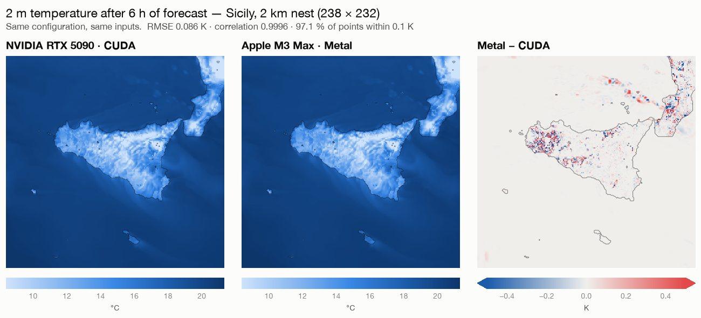

# ArWen on Apple Silicon

**English** · [Italiano](README.it.md)

### A WRF-class regional weather model running natively on a Mac GPU

This repository is **[ArWen](https://github.com/recastsystems/arwen)** — Recast
Systems' GPU implementation of the WRF-ARW model family (Apache-2.0) — with an
added **Apple Metal backend**.  ArWen is the original and main project: the
dynamical core, the physics, the data paths and the tooling are theirs, and
their own README is kept as [`README-ArWen.md`](README-ArWen.md).  This fork
adds one thing: ArWen's CUDA forecast kernels run on the GPU of an Apple
Silicon Mac, with no NVIDIA hardware, no CUDA runtime and no emulator in
between.

To our knowledge this is the first time a full WRF-ARW-class forecast — nested
domains, Thompson microphysics, MYNN boundary layer, RRTMG radiation, Noah land
surface, Tiedtke convection — runs natively on a Mac GPU.

<picture>
  <source media="(prefers-color-scheme: dark)" srcset="docs/metal-assets/t2_6h_dark.png">
  
</picture>

*The same 6 h forecast computed by stock ArWen on an NVIDIA RTX 5090 and by
this backend on a MacBook Pro's M3 Max.  The difference map shows what is left:
scattered round-off grown by six hours of a chaotic model, mostly over land
where convection and the surface scheme amplify it.*

```sh
gpuwm go /path/to/wrf_run_dir --backend metal --history-compression none
```

**At a glance**

| | |
|---|---|
| what runs | ArWen's own CUDA kernels, translated to Metal at first use — no hand-written port, no NVIDIA hardware, no emulator |
| forecast | operational two-domain WRF configuration (6 km / 2 km, 45 levels): 1 h and 6 h runs complete |
| against an RTX 5090 | word-identical at 00:00; after 6 h, 2 m temperature RMSE 0.09 K and surface pressure correlation 1.0000 |
| reproducibility | 142 775 319 output words identical from run to run, re-checked after every change |
| exactness checks | binary64 emulation 0 ulp; FP32 gradual underflow, translator constructs and `goto` elimination 0 differing words; glibc libm fast paths verified on all 2³² inputs |
| coverage | all 342 CUDA translation units and 46 / 46 production loaders build |
| ArWen's GPU test suite | 13 458 tests: 150 failing (1.1 %), 513 skipped as not applicable on a Mac with a stated reason, the rest passing |
| speed | 1 simulated hour in 81–240 s on an M3 Max laptop (RTX 5090: ~11 s) |

---

## Contents

1. [Results](#results)
2. [How it works](#how-it-works)
3. [Verification](#verification)
4. [What the port found](#what-the-port-found)
5. [Coverage](#coverage)
6. [Getting started](#getting-started)
7. [Configuration](#configuration)
8. [Known limitations](#known-limitations)
9. [What is left, and what can be solved](#what-is-left-and-what-can-be-solved)
10. [Repository map](#repository-map)
11. [Credits and license](#credits-and-license)

---

## Results

Measured on an **Apple M3 Max** (30-core GPU, 36 GB unified memory, macOS 27.2,
Xcode 27.2, Metal toolchain 32023.922), against the same configuration run by
stock ArWen 3.0.3 on an **NVIDIA RTX 5090**.

**The configuration** is an operational one: two one-way nested domains over
Sicily — d01 176×152 at 6 km, d02 238×232 at 2 km — 45 levels, `hybrid_opt=2`,
`p_top=5000`, adaptive time step; Thompson (`mp_physics=8`), Tiedtke
(`cu_physics=6`, d01), RRTMG LW/SW (`ra_*_physics=4`), MYNN PBL and surface
layer (5/5), Noah LSM (`sf_surface_physics=2`), `diff_opt=1`, `km_opt=4`,
`sst_update=1`.  Input: WRF `real.exe` files.  Output: classic NetCDF `wrfout`,
readable by UPP.

**It runs to completion** — 1 h (309 steps) and 6 h (1 859 steps) forecasts,
following the same adaptive time-step sequence as the CUDA run.

**It agrees with CUDA** within the chaotic growth of round-off.  At 00:00 the
fields are word-identical; after that, Metal − CUDA:

| field | RMSE 1 h d01 | RMSE 1 h d02 | RMSE 6 h d01 | RMSE 6 h d02 | corr 6 h d02 |
|---|---|---|---|---|---|
| 2 m temperature (K) | 0.039 | 0.055 | 0.045 | 0.086 | 0.9996 |
| 10 m wind speed (m/s) | 0.016 | 0.014 | 0.038 | 0.076 | 0.9994 |
| surface pressure (Pa) | 0.30 | 0.076 | 0.46 | 1.26 | 1.0000 |
| accumulated rain (mm) | 7.6e-5 | 2.4e-5 | 0.017 | 0.057 | 0.979 |

**It is deterministic** — repeated runs of the same build produce the same
142 775 319 output words, bit for bit.

**Speed** — one simulated hour takes 81–240 s of wall time on the M3 Max
depending on what else the machine is doing (best measured: median step 0.23 s
on d02, 0.13 s on d01); six hours took 885 s.  The RTX 5090 does an hour in
about 10.6 s: a 575 W desktop card with 1.8 TB/s and native FP64, against a
laptop GPU that has to emulate FP64 in software (below).

## How it works

The CUDA sources stay canonical.  Nothing is ported by hand: every kernel ArWen
compiles at run time is translated to the Metal Shading Language the first
time it is needed, compiled, and cached.

```
ArWen (Python)  ──  calls CuPy  ──►  gpuwm/metal/shim.py installs gpuwm/metal/xp as "cupy"
                                       arrays live in unified memory; kernels are Metal
CUDA kernel source + NVRTC options (exactly what ArWen's loaders build)
   │  clang preprocess with NVRTC's predefined macros
   │  libclang parse, CUDA device mode, against gpuwm/metal/cuda_parse.h
   ▼
gpuwm/metal/transpile.py — AST-driven rewrite to MSL
   │  xcrun metal → AIR (.metallib), cached in ~/.cache/arwen-metal
   ▼
gpuwm/metal/native/arwen_metal_rt.mm — MTLDevice, buffers, pipelines,
   ordered command buffers (GPU-only MTLEvent chain), buffer pool
```

The hard problems and how they were solved (details and measurements in
[`docs/metal-backend.md`](docs/metal-backend.md)):

* **No FP64 on Apple GPUs.**  Weather physics needs binary64 in many places
  (Thompson tables, ArWen's correctly rounded `f64cr` math, Noah, RRTMG).
  `double` becomes `__f64`, a correctly rounded IEEE binary64 implemented in
  integer arithmetic (`arwen_sf64.h`): 0 ulp for + − × ÷ √ fma, checked on
  special values and on millions of random operands against the CPU; double
  libm functions within 1–4 ulp, declared per function.
* **FP32 subnormals flushed by the hardware.**  Apple GPUs before family 11
  flush float denormals.  Modules ArWen compiles with CUDA `--ftz=false` route
  every float operation through helpers that recover gradual underflow
  exactly, with a cheap result-only test so the common case stays fast.
* **glibc-exact float libm copies.**  ArWen ships glibc's `logf`/`expf`/`powf`
  for bitwise WRF agreement; they evaluate in binary64, which is expensive
  here.  They are routed to float-float fast paths whose agreement with the
  glibc copy is verified over **all 2³² inputs** before a route is enabled.
* **CUDA → MSL.**  Address spaces are inferred from data flow (device,
  thread, threadgroup, constant); device functions are monomorphised per
  address space; `goto` (translated Fortran) is eliminated exactly; inheritance
  is flattened; warp intrinsics map to SIMD-groups; array views that wrap both
  local and device storage get their pointer type as a template parameter;
  inline PTX patterns are mapped one by one.  Anything the translator cannot
  express is a `TranslationError` — never a silent change.
* **Apple's GPU back-end compiler.**  For a handful of very large kernels the
  `-O3` back-end compile takes tens of minutes; the runtime then uses `-Os`
  AIR (verified to compute the same words) and remembers the kernel.
* **Host overhead.**  A GPU-only ordering chain, eager commits, a buffer pool
  and cached argument packing cut the host's share of an hour's run from most
  of it to a small fraction.

## Verification

Each piece has a check with a declared tolerance and a measured result:

| check | result |
|---|---|
| 1 h / 6 h forecast vs RTX 5090 | table above |
| 1 h forecast, Metal run vs Metal run | 0 of 142 775 319 words differ (repeated after every change to the translator, runtime or array layer) |
| Tiedtke (cu6) column cases vs CUDA | 0 differing words |
| HRRR-fork Thompson column vs the fork's Fortran oracle | every output cell, word for word |
| binary64 emulation (`tests/metal/sf64_gpu_check.py` + host checks) | 0 ulp core operations |
| FP32 gradual underflow (`tests/metal/ftz_false_gpu_check.py`) | 0 of 4 194 304 words |
| CuPy-compatible array layer vs NumPy (`tests/metal/xp_parity_check.py`) | 124 checks, 0 failures |
| translator constructs vs native clang (`tests/metal/translator_features_check.py`) | 27 cases, 0 differing words |
| ensemble members packed into one batch vs run one by one (packed, scheduled, batched RRTMGP) | 30 / 30 tests, word for word |
| `goto` elimination vs native clang (`tests/metal/goto_semantics_check.py`) | 8 shapes incl. SSiB NEWTON and a jump into a sibling branch (Noah-MP), 0 differing words |
| Kain-Fritsch (KF-CuP) columns vs WRF's Fortran oracle, `GPUWM_WRF_EXACT=1` | 0 differing words, 5 configurations |
| glibc libm fast paths (`tools/metal/verify_fastlibm.py`) | all 2³² inputs per routed function, 0 mismatches |
| ArWen's own GPU test suite on Metal (13 458 tests) | 150 failing (1.1 %); 513 skipped as not applicable on a Mac, each with its reason; every other test passing or skipped by ArWen's own conditions (2026-11-19) |

The 513 skips are listed one by one in `tests/metal_not_applicable.py` and
applied by `tests/conftest.py` only when `GPUWM_BACKEND=metal`; pytest prints
the reason of each.  A test is listed only with evidence for its class:

| class | tests | why it does not apply on a Mac |
|---|---|---|
| `ptx` | 212 | PTX / NVRTC-direct compiles, nvJitLink, cubin — Metal has no PTX |
| `arwen_drift` | 155 | fails on any backend in ArWen 3.0.3 (same failure on an RTX 5090, or an error in the test's own fixture) |
| `cuda_hash_pin` | 57 | SHA-256 pins of CUDA's output words, which encode `ptxas` FMA contraction (Metal is often closer to the WRF oracle) |
| `macos_reference` | 33 | the CPU reference runs on the Mac with Apple's libm or NumPy arm64 (Metal matches glibc there) |
| `cuda_host_only` | 19 | data, tools or environment present only on the Linux/CUDA machine |
| `kf_default_tolerance` | 15 | KF-CuP default-numerics word counts, which the RTX 5090 fails as well; with `ARWEN_METAL_STRICT_GLIBC=1` they run here, and pass word-exact |
| `cuda_introspection` | 14 | CUDA local-memory frames, registers, NVRTC builtin behaviour |
| `native_libm` | 8 | ULP distance from WRF pinned for CUDA's hardware `powf`; Apple's `powf` rounds differently in the last bit (Exner `pi_phy`: 1826 vs 304 of 5880 words 1 ULP from WRF) |

The 150 tests that still fail stay in the suite.  Each failing file was also
run on the RTX 5090, one process per file: 105 of these tests pass there, so
they are Metal-side; 11 fail there for a different reason; 34 are in files
the CUDA run did not cover.  Grouped by their messages:

| what | tests |
|---|---|
| numerical differences against CUDA-measured pins or tolerances, and other assertions to investigate | 90 |
| Apple's shader compiler crashing or giving up on the largest kernels | 25 |
| array-layer / CUDA-API functions not provided yet (`matmul`, `memcpyPeerAsync`, …) | 23 |
| memory and allocation accounting that differs from CUDA's | 12 |

## What the port found

Running a large CUDA code base on a second, very different GPU is also a test
of the code base.  Besides the Metal backend, this work produced findings for
ArWen and for anyone porting CUDA to Apple GPUs.

**In ArWen 3.0.3** (all reproduced on the RTX 5090, not Metal effects):

* **155 GPU tests fail on any backend** — the tests and the code have drifted
  apart (configurations missing attributes the code now reads, changed
  keyword arguments, outdated expected values).  Each is listed in
  `tests/metal_not_applicable.py` as `arwen_drift`.
* **Nested ensembles with map-factor feedback** (`mapped=True`): the batched
  path does not feed the map factors back the way the scalar path does
  (surface `copy_fcnm`); 24 tests fail identically on CUDA.
* **Kain-Fritsch default numerics**: KF's word-count tests fail on CUDA as
  well (`rthcuten` 1189 words off on the RTX 5090, 1255 on Metal); only the
  glibc-exact path is word-exact.
* **A CUDA speed-up**: the float-float fast paths built here for the glibc
  `logf`/`expf`/`powf` copies also work on NVIDIA GPUs.  They are offered
  upstream as an opt-in change, verified on the RTX 5090 over all 2³² inputs
  and on a complete 1 h forecast (identical `wrfout` SHA-256):
  [recastsystems/arwen#8](https://github.com/recastsystems/arwen/pull/8).

**Defects that compiled cleanly and were caught by the checks** (all fixed):

* overlapping backward `goto` regions jumping to the wrong label (SSiB's
  translated Fortran);
* kernels launched with more threadgroup memory than the device has (they now
  fail loudly, as on CUDA);
* `cupy.take(..., out=)` returning a new array instead of writing `out`: the
  RRTMGP surface emissivity of every ensemble member but the first then came
  from stale memory.  Found by hashing every kernel's buffers before and after
  each dispatch in the packed and in the one-by-one runs and stopping at the
  first difference;
* libclang, run inside a free-threaded Python 3.14 process, corrupting Python
  objects at random (now it translates in a child process);
* a deadlock between Metal's completion handler and the dispatcher in the
  native runtime.

**Numerics, measured:**

* Apple's GPU `logf` agrees with glibc where Apple's CPU libm does not
  (`logf(8841.5107)`: glibc and Metal `0x41116539`, macOS libm `0x4111653a`) —
  so a CPU reference computed on a Mac can be the wrong reference.
* CUDA's output words depend on where `ptxas` chooses to contract `a*b+c`
  into an FMA; Metal computes without contraction and is often *closer* to
  the WRF Fortran oracle than CUDA is.
* Apple's and NVIDIA's hardware `powf` differ in the last bit; in ArWen's
  default numerics that moves the Exner function `pi_phy` 1 ULP from WRF in
  1826 of 5880 words on Metal, 304 on CUDA.  The glibc-exact path removes it.

## Coverage

ArWen has 342 CUDA translation units in `gpuwm/core/kernels`, plus kernels
composed by scheme-specific loaders and inline kernels.  On Metal **all of
them build**: 309 the generic way (`tools/metal/compile_all_units.py`; the
other 33 are fragments that only their loaders can assemble) and 46 / 46
through ArWen's production loaders (`tools/metal/compile_loader_units.py`),
with ArWen's default numerics and with `GPUWM_WRF_EXACT=1`.

## Getting started

**Requirements**: a Mac with Apple Silicon (M1 or newer; developed on an M3
Max with 36 GB), macOS with Xcode or the command line tools plus the Metal
toolchain (`xcodebuild -downloadComponent MetalToolchain`), Python ≥ 3.11.
Rust (`cargo`) is needed only for the ArWen tools that are written in Rust.

```sh
git clone https://github.com/giuseppegambino92/arwen-apple-metal.git arwen && cd arwen
uv venv && source .venv/bin/activate
uv pip install -e '.[metal]'
gpuwm go /path/to/wrf_run_dir --backend metal --history-compression none \
         --rrtmg-variant rrtmg_legacy --outdir runs/first
```

`/path/to/wrf_run_dir` holds `namelist.input`, `wrfinput_d0*` and `wrfbdy_d01`
written by WRF's `real.exe` (ArWen's `native-wrf` route).  Everything else in
ArWen — `gpuwm domain`, data sources, rendering, GRIB2 export — works as its
own documentation describes.  The first run of a configuration translates and
compiles its kernels (a few minutes); later runs start from
`~/.cache/arwen-metal`.

ArWen's Rust tools build natively (`cargo build --release --locked` in each
`tools/*` crate; `hydro_proj` needs `cmake`, e.g. `brew install cmake`; in
`tools/rustwx` build packages with `-p`, since `fire-indices` needs CUDA).

Running ArWen's tests on Metal:

```sh
GPUWM_BACKEND=metal python -m pytest -p gpuwm -m gpu -n 6 -o faulthandler_timeout=1000 tests/
python tests/metal/translator_features_check.py      # and the other tests/metal checks
```

## Configuration

| variable | effect |
|---|---|
| `GPUWM_BACKEND=metal` (or `--backend metal`) | select the Metal backend |
| `ARWEN_METAL_STATS=1` | print runtime counters at exit |
| `ARWEN_METAL_TIMELINE=path` | write a GPU/host timeline |
| `ARWEN_METAL_PIPELINE_BUDGET=s` | seconds allowed for an `-O3` back-end compile before `-Os` (default 90) |
| `ARWEN_METAL_OPT=-Os` | build every kernel from `-Os` AIR |
| `ARWEN_METAL_KEEP_FAILED=dir` | keep the MSL of a module that failed to compile |
| `ARWEN_METAL_CACHE=dir` | cache directory (default `~/.cache/arwen-metal`) |
| `ARWEN_METAL_STRICT_GLIBC=1` | default forecasts keep ArWen's glibc-exact libm copies in KF-CuP, SSiB, NSSL2 and the 2-D Smagorinsky exp instead of Metal's native float math: word-exact against WRF's oracles (KF 5/5 configurations), about 2.4x slower in KF |
| `ARWEN_METAL_NVRTC_VERSION=13.4` | the NVRTC version reported to code that selects CUDA-toolchain-measured tables (default 13.4, with compute capability 12.0: Metal is gated by the RTX 5090 rows) |

## Known limitations

* **Speed.**  An M3 Max is roughly an order of magnitude slower than an RTX
  5090 on this workload; FP64 emulation and FP32 underflow recovery cost most
  of it.
* **Not bit-identical to CUDA.**  Metal agrees with the RTX 5090 statistically,
  not word for word: GPU math libraries (`expf`, `powf`, …) differ in the last
  bit between CUDA and Metal, CUDA's `ptxas` contracts `a*b+c` into FMAs at
  its discretion under `--fmad=true` (Metal compiles without contraction), and
  differences grow with time as in any chaotic model.  Where WRF-exact numerics
  are requested (`GPUWM_WRF_EXACT=1`, glibc libm copies, explicit `_rn`
  operations) Metal reproduces WRF's words, as the KF and Thompson oracles show.
* **What ArWen's test suite measures here.**  Besides real defects (each fixed
  as found, see `docs/metal-backend.md`), the tests that cannot pass on a Mac
  fall into classes that have nothing to do with the GPU:
  - tests that pin the SHA-256 of CUDA's output words (they encode `ptxas`'s
    FMA choices; Metal is often *closer* to the WRF oracle there);
  - CPU references computed on the Mac itself, which link Apple's libm instead
    of glibc (e.g. `logf(8841.5107)`: glibc and Metal give `0x41116539`, Apple
    `0x4111653a`) or use NumPy on arm64 (signed-zero ties of `maximum`);
  - CUDA-only machinery: PTX/cubin patching, nvJitLink, local-memory frame
    sizes (Metal reports 0, so frame-budget tests pass without measuring
    anything), Linux-only tools (`troute_mc_replay`, a ptrace tracer), data
    recorded on the CUDA machine (`HYDRO_CLOCK_BASELINE`);
  - ArWen's default (non-exact) numerics in Kain-Fritsch: with the GPU's own
    `expf`/`powf`, KF's word-count checks fail on the RTX 5090 too, by similar
    amounts (`rthcuten`: 1189 words off on CUDA, 1255 on Metal).  Native math
    stays the default on Metal (2.4x faster in KF);
    `ARWEN_METAL_STRICT_GLIBC=1` or `GPUWM_WRF_EXACT=1` make KF word-exact
    against WRF's Fortran oracle, and these tests then run and pass.
* **Some NumPy functions run on the CPU.**  Functions the array layer has no
  Metal kernel for (`sort`, `unique`, `median`, `linalg`, …) run in NumPy on
  the same unified memory, declared on first use; none is on the forecast's
  time-step path.
* **First use of the largest kernels** can take minutes (Apple's back end);
  the result is cached.
* **GPU-side timing receipts** that read `%globaltimer` read 0 (MSL has no
  device clock).
* **CUDA-only machinery** — PTX/cubin images, nvJitLink, CUDA local-memory
  frame sizes, multi-GPU — does not apply.
* **No 64-bit compare-and-swap.**  Apple GPUs have none; the Grell-Freitas
  "lanes" variant that needs it stops at compile time with that reason
  (64-bit `atomicAdd` is emulated exactly with two 32-bit atomics).

## What is left, and what can be solved

Almost everything that is left is engineering, not a wall.

| what | tests | solvable? |
|---|---|---|
| array-layer / CUDA-API functions not written yet (`matmul`, `memcpyPeerAsync`, cooperative launches, …) | 23 | **yes** — each is a self-contained function of the CuPy-compatible layer |
| memory and allocation accounting differing from CUDA's | 12 | **yes** — the layer reports unified-memory sizes; CUDA's pool rounding can be mirrored |
| Apple's shader compiler crashing or giving up on the largest kernels | 25 | **yes, with work** — split the kernels, lower register pressure, or wait for Apple's fix (the failures are reproducible and reportable) |
| numerical differences against CUDA-measured pins, other assertions | 90 | **mostly** — each needs its own look: last-bit libm differences can be closed by routing to the verified glibc copies (exact, slower); some are real bugs still to find |

What cannot be done, by design:

* **Bit-identical to CUDA.**  CUDA's words encode `ptxas`'s private FMA
  contraction decisions and NVIDIA's libm; Metal can reproduce WRF's words
  (as the KF and Thompson oracles show), not NVIDIA's compiler's.
* **PTX, cubin, nvJitLink** — there is no PTX on Apple GPUs (212 tests).
* **64-bit compare-and-swap in hardware** — absent on Apple GPUs; an emulation
  with locks is possible but slow, and only one optional variant needs it.
* **RTX 5090 speed** — a laptop GPU emulating FP64 in software stays about an
  order of magnitude slower than a 575 W desktop card with native FP64.

## Repository map

| path | what |
|---|---|
| `gpuwm/metal/transpile.py`, `frontend.py`, `cuda_parse.h` | CUDA → MSL translator |
| `gpuwm/metal/include/` | MSL headers: CUDA compatibility, binary64 emulation, double libm, verified fast paths |
| `gpuwm/metal/native/arwen_metal_rt.mm` | native Metal runtime (nanobind) |
| `gpuwm/metal/runtime.py`, `msl_compile.py` | modules, kernels, launches, compile cache, pipeline policy |
| `gpuwm/metal/xp/`, `shim.py` | CuPy-compatible array layer on unified memory |
| `gpuwm/metal/fastlibm.py` | verified routing of the glibc libm copies |
| `tests/metal/`, `tools/metal/` | exactness checks, coverage gates, comparison tools |
| `tests/metal_not_applicable.py` | the 513 tests skipped on Metal, each with its class and reason (`tools/metal/build_applicability_registry.py` builds it) |
| `docs/metal-evidence/` | 1 h bitwise regression receipts |
| `docs/metal-backend.md` | design notes and every measurement, in order |

## Credits and license

ArWen is © Recast Systems and its contributors, released under the Apache
License 2.0 — see [`LICENSE`](LICENSE), [`NOTICE`](NOTICE) and
[`README-ArWen.md`](README-ArWen.md).  The Metal backend (`gpuwm/metal/`,
`tests/metal/`, `tools/metal/`, `docs/metal-backend.md`) is contributed under
the same license.  WRF is public-domain software from NCAR/UCAR; the physics
this model reproduces belongs to the WRF community.
